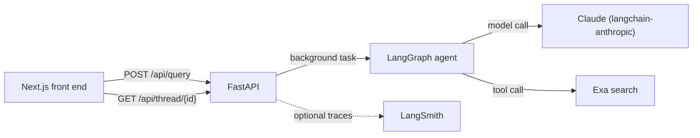

# AI Assistant API

A FastAPI backend for a research chat assistant: a LangGraph agent answers with Claude and calls Exa web search when a question needs current information.

[](https://github.com/dpelezo/AI-Assistant-API/actions/workflows/ci.yml)


- **Live demo:** [ai-assistant-frontend-beta.vercel.app](https://ai-assistant-frontend-beta.vercel.app) (front end in [AI_assistant_frontend](https://github.com/dpelezo/AI_assistant_frontend))
- **API docs:** [ai-assistant-api-dpelezos-projects.vercel.app/docs](https://ai-assistant-api-dpelezos-projects.vercel.app/docs)

## How it works



1. `POST /api/query` stores the user's message, returns a `thread_id` at once, and runs the agent in a background task.
2. The agent loop alternates between Claude and the `retrieve_web_content` tool (Exa, top 6 results with highlights) until Claude answers without a tool call.
3. The client polls `GET /api/thread/{thread_id}` for the AI reply. If the model call fails, the reply is a short notice marked `"is_error": true`; the full error goes to the logs only.
4. Deep research (`POST /api/research/query`) runs several search-and-summarize iterations (default 3, maximum 5) and is polled through `/status` and `/result`. If Claude cannot write the report, the result lists the sources found, with short excerpts.

## Testing and quality checks

CI runs on every push and pull request: Ruff (pinned to 0.17.6) and pytest on Python 3.11.

The tests never call a live model or LangSmith. They cover:

- `/health`
- `POST /api/query` with a fake LangGraph graph: the thread ID, the system and user messages sent to the agent, and the stored AI reply
- Conversation history carried into the next message of the same thread
- `404` for an unknown thread
- Every debug route returning `404` unless `DEBUG=true`
- Friendly error messages: no API credit, a bad key or a rate limit shows a short notice, never the provider's error text
- Search results formatted as clean text, and the deep research fallback report when the model is unavailable
- The LangSmith run helpers, using a fake client

Not covered yet: the live Exa API and report quality.

## Known limitations

- **Threads live in memory.** They are lost when the process restarts, and on Vercel's serverless functions they may not survive between requests. Saving threads to the LangGraph checkpointer currently fails (`KeyError: 'checkpoint_ns'`) and is logged as an error.
- **Polling, not streaming.** The client polls for the reply instead of receiving a stream.
- **No authentication or rate limiting.** Do not expose it publicly with a paid API key and no usage cap.

**Maintenance note (November 2026):** the API was still pinned to `claude-3-5-sonnet-20240620`, which Anthropic retired in October 2025, and the `MODEL_NAME` setting meant to override it was silently ignored. The model is now read from `LLM_MODEL` (default `claude-haiku-5-5`).

## Run it locally

Prerequisites: Python 3.11+, an Anthropic API key, and an Exa API key. Docker and a LangSmith key are optional.

```bash
git clone https://github.com/dpelezo/AI-Assistant-API.git
cd AI-Assistant-API
python3.11 -m venv .venv && source .venv/bin/activate
pip install -r requirements.txt
cp .env.example .env          # then add your keys
uvicorn app.main:app --reload # http://localhost:8000/docs
```

With Docker:

```bash
docker compose up -d
docker compose logs -f
```

Run the checks that CI runs:

```bash
pip install ruff==0.17.6
ruff check app tests
pytest -q
```

## Configuration

Settings are read from environment variables or `.env`. See [`.env.example`](.env.example) for every name.

| Variable | Default | Purpose |
|----------|---------|---------|
| `ANTHROPIC_API_KEY` | (none) | Claude access |
| `EXA_API_KEY` | (none) | Web search |
| `LLM_MODEL` | `claude-haiku-5-5` | Claude model ID |
| `LLM_TEMPERATURE` | unset | Leave unset. Current Claude models (Haiku 5.5, Sonnet 5.5, Opus 5.5) return a 400 error for any value other than 1. |
| `LLM_MAX_TOKENS` | `16000` | Maximum output tokens per model call, including adaptive thinking. Keep it under about 21,000: above that the Anthropic SDK requires streaming. A reply that hits the limit ends with a note saying it was cut off. |
| `BACKEND_CORS_ORIGINS` | `["*"]` | Allowed front-end origins; set this to your front-end URL in production |
| `DEBUG` | `false` | Turns on the `/debug` routes and debug logging |
| `DEFAULT_RESEARCH_ITERATIONS` / `MAX_RESEARCH_ITERATIONS` | `3` / `5` | Deep research limits |
| `LANGSMITH_API_KEY`, `LANGSMITH_TRACING`, `LANGSMITH_PROJECT` | off | Optional tracing; see the [LangSmith guide](docs/langsmith-guide.md) |

## API endpoints

| Endpoint | Method | Description |
|----------|--------|-------------|
| `/api/query` | POST | Send a message; body `{"content": "...", "thread_id": null}` |
| `/api/thread/{thread_id}` | GET | Get a thread's messages |
| `/api/thread/{thread_id}` | DELETE | Delete a thread |
| `/api/research/query` | POST | Start deep research; body `{"query": "...", "iteration_limit": 3}` |
| `/api/research/status/{research_id}` | GET | Research progress |
| `/api/research/result/{research_id}` | GET | Research report |
| `/api/` | GET | API information |
| `/health` | GET | Health check |
| `/docs`, `/redoc` | GET | Interactive API docs |

Debug routes, available only when `DEBUG=true`: `/api/debug/threads`, `/api/research/debug/latest`, `/api/research/debug/all` and `/api/research/debug/report/{research_id}`.

## Project structure

```
app/
├── api/
│   ├── dependencies.py     # shared state and the debug-route guard
│   ├── endpoints/
│   │   ├── chat.py         # chat endpoints
│   │   └── research.py     # deep research endpoints
│   └── router.py
├── core/
│   ├── config.py           # settings (pydantic-settings)
│   ├── langsmith_setup.py  # optional LangSmith tracing
│   └── workflow.py         # LangGraph agent loop
├── models/                 # Pydantic models
├── services/
│   ├── ai.py               # Claude client and system prompt
│   ├── deep_research.py    # multi-iteration research
│   ├── memory.py           # LangGraph checkpointer
│   └── web_search.py       # Exa search tool
├── utils/logging.py
└── main.py
tests/                      # pytest suite (no live API calls)
docs/langsmith-guide.md
```

## License

[MIT](LICENSE) © 2025 Domingos Pelezo
